<div align="center">


# Flower

**A 3D flower drawn in letters &nbsp;·&nbsp; seven flowers &nbsp;·&nbsp; ten palettes &nbsp;·&nbsp; six character sets &nbsp;·&nbsp; five endings**

It grows from a single dot, blooms, turns, and carries your note written across its petals.<br />
Send it as a link that opens straight into the bloom for them. Then the wind takes it.

[](https://msreeganeshnaik.github.io/flower/)

[](https://nextjs.org/)
[](https://react.dev/)
[](https://www.typescriptlang.org/)
[](lib/engine)
[](#stills-rendered-on-your-own-gpu)
[](#the-film)
[](LICENSE)

[**Live demo**](https://msreeganeshnaik.github.io/flower/) &nbsp;·&nbsp; [Tour](#the-tour) &nbsp;·&nbsp; [What's inside](#whats-inside) &nbsp;·&nbsp; [Stills](#stills-rendered-on-your-own-gpu) &nbsp;·&nbsp; [Film](#the-film) &nbsp;·&nbsp; [Run it](#run-it) &nbsp;·&nbsp; [How it's built](#how-it-is-built) &nbsp;·&nbsp; [Credits](#credits)

<br />

<a href="https://msreeganeshnaik.github.io/flower/">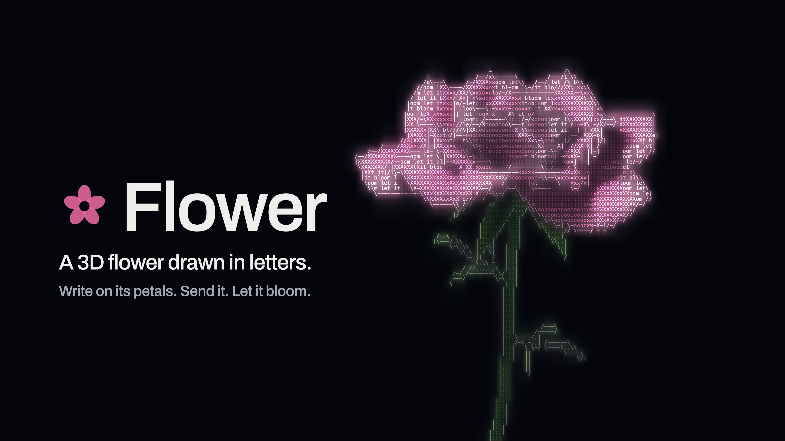</a>

<sub>The rose in the Natural palette and the Classic character set, on the Night ground.</sub>

</div>

<br />

Every picture on this page was drawn by Flower itself, at 3840 × 2160, in the browser on an Apple M4 Pro. Nothing was rendered in the cloud and nothing was upscaled. See [Stills](#stills-rendered-on-your-own-gpu).

---

## The tour

<table>
<tr>
<td width="50%">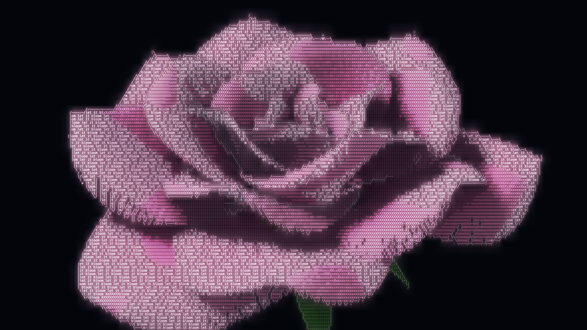<br /><sub><b>Made of letters.</b> One character per cell, picked by how much light lands there. Your words are written into the petals; here, “let it bloom”.</sub></td>
<td width="50%">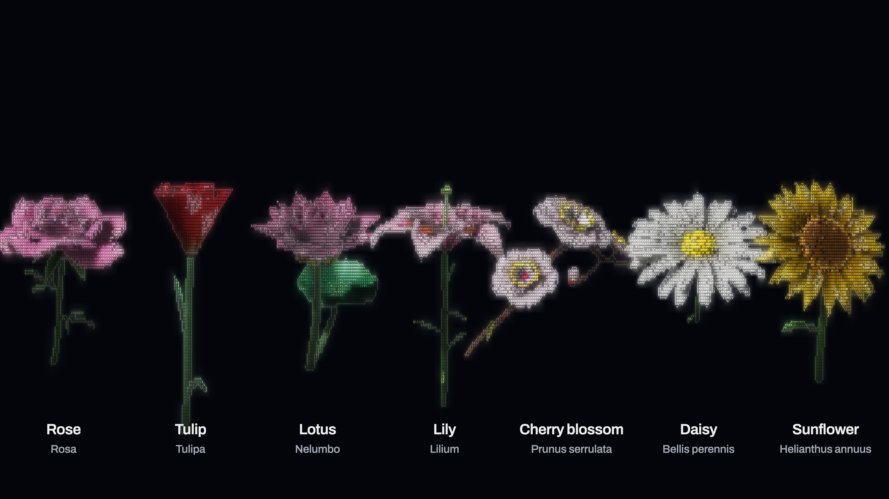<br /><sub><b>Seven flowers.</b> Rose, tulip, lotus with its leaf, lily, cherry blossom, daisy and sunflower, each built from real petal geometry.</sub></td>
</tr>
<tr>
<td>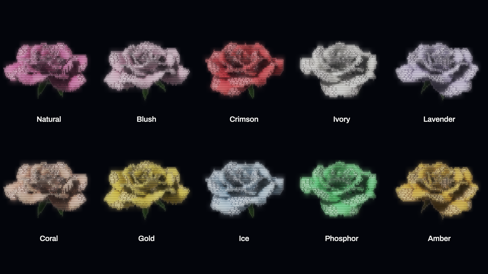<br /><sub><b>Ten palettes.</b> Natural, Blush, Crimson, Ivory, Lavender, Coral, Gold, Ice, and the one-colour displays Phosphor and Amber.</sub></td>
<td>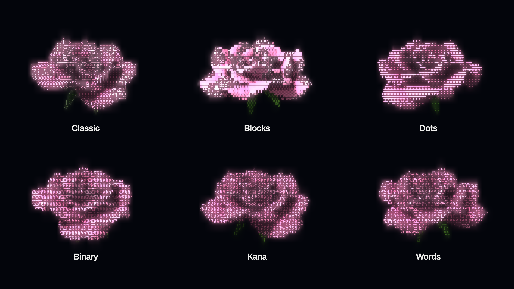<br /><sub><b>Six character sets.</b> Classic, Blocks, Dots, Binary, Kana and Words. The same light, a different alphabet.</sub></td>
</tr>
<tr>
<td>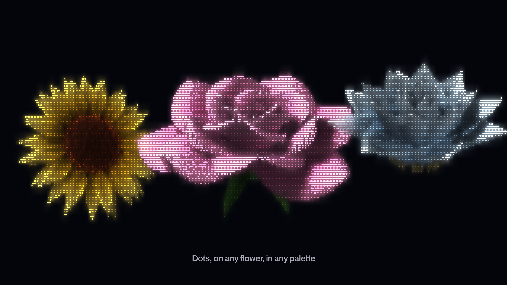<br /><sub><b>Or made of dots.</b> The Dots set works on any flower, in any palette.</sub></td>
<td>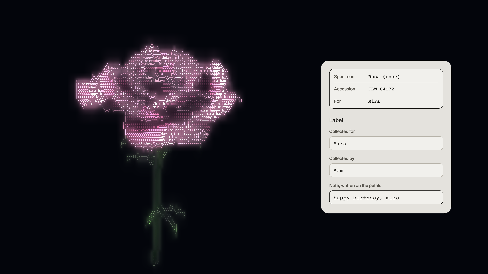<br /><sub><b>Your words, on its petals.</b> Fill in the label slip: who it is for, who it is from, and the note that gets written across the bloom.</sub></td>
</tr>
<tr>
<td>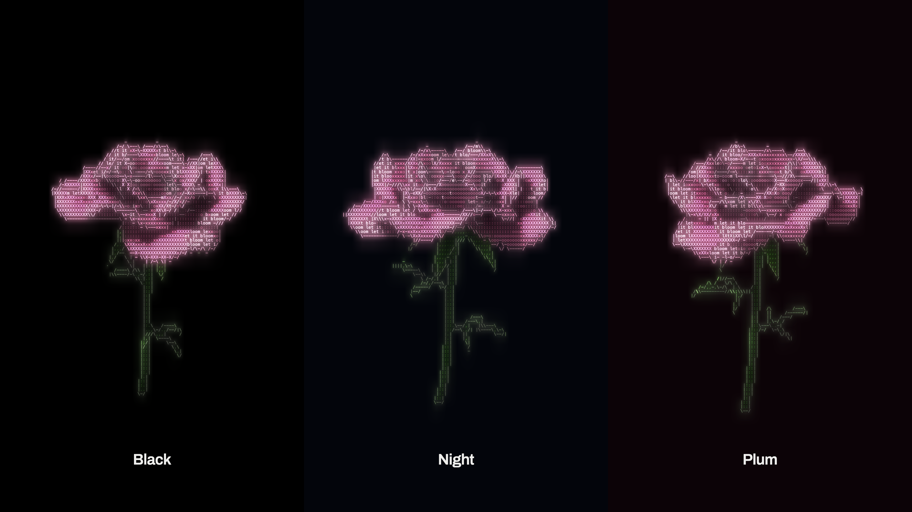<br /><sub><b>Three grounds.</b> Black, Night and Plum.</sub></td>
<td>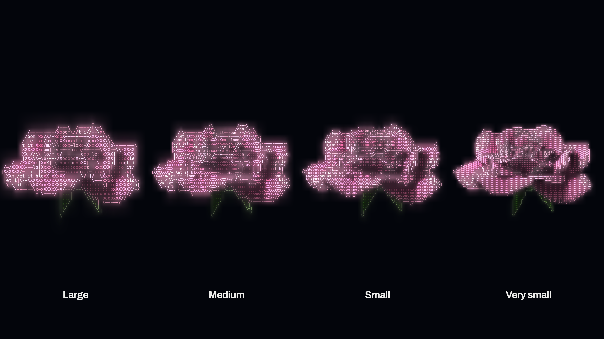<br /><sub><b>Four character sizes.</b> Large to Very small: the smaller the characters, the finer the flower.</sub></td>
</tr>
</table>

<div align="center">
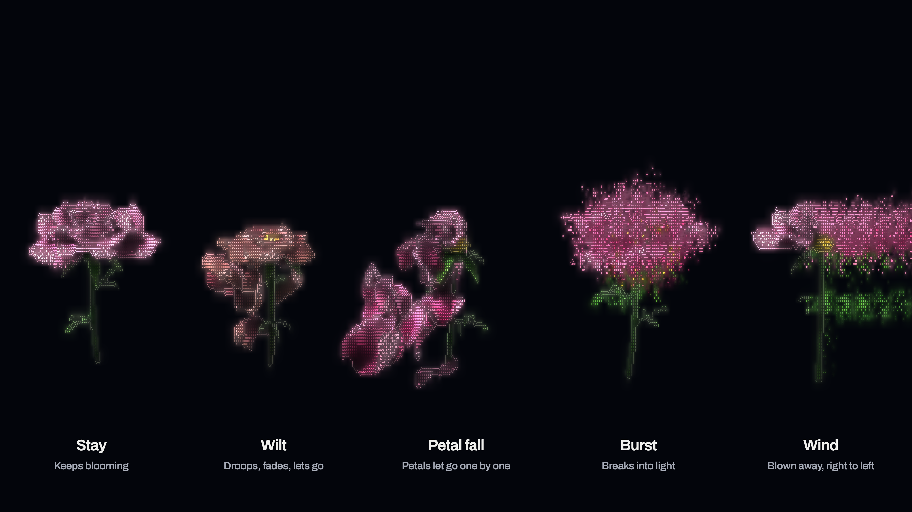
<br /><sub><b>Five endings.</b> It stays, wilts, lets its petals go one by one, bursts into light, or the wind takes it.</sub>
</div>

---

## What's inside

**The flowers**

- Seven species, each real geometry rather than a picture: petals with veins, ruffled and notched edges and midrib folds, sepals, stems and leaves.
- The rose's spiral of petals, the tulip's cup, the lotus with a real Nelumbo leaf (round, cupped, on its own stalk, with pale veins), the lily's spots and long stamens, a cherry branch with buds, the daisy's ray florets and the sunflower's seed spirals.
- Every flower grows from a single dot into a bud, blooms, turns slowly, then plays its ending.

**Light, in characters**

- A shadow map from the key light, shading in the creases between petals, light coming through thin petals, and a velvet sheen.
- Each cell of the grid gets one character, chosen by brightness from the current set. Your phrase runs across the petals row by row.
- A soft glow built from the same image at half and quarter size.

**Looks**

- 10 palettes, 6 character sets, 3 grounds and 4 character sizes, plus Brightness and Glow sliders.
- The interface is dressed as a herbarium: the flower on black mounting board, the controls on a bone paper label slip with typed fields and an accession stamp.

**Gift links**

- Every setting lives in the link. Copy gift link and send it; it opens straight into the bloom with your note, with no editor in the way, then offers Replay and Make your own.
- No accounts and no server: the flower is drawn on the recipient's own device.

**Export**

- **Clips:** record a 1080-wide clip as Reel 9:16, Square, Portrait 4:5 or Wide 16:9 (MP4 where the browser supports it, WebM otherwise).
- **Images:** drag the flower to any angle or pick Front, Angled, Side or Above, choose the moment, then download PNG or JPG at HD, 2K or 4K; an SVG in which every character is live text; or a looping animated GIF of a full turn or the whole bloom. PNG and SVG can drop the background.
- On phones, a finished file offers **Save or share**, which opens the share sheet so it goes straight to Photos or an app.

**Keys:** `Space` play or pause · `R` replay · `←` `→` previous or next flower · `H` hide the interface · `E` export image.

---

## Stills, rendered on your own GPU

The pictures in this README are a set of eleven 4K plates (`film/src/plates.ts`): ten set pieces plus the film's poster. Each one is drawn by the real engine at its native size, with the type drawn as vector text on the same canvas, then saved as a lossless PNG. There is no separate renderer and no upscaling: a plate is the live drawing with the pixel budget lifted, on whatever GPU your browser is using.

**In the browser.** Open the [film page](https://msreeganeshnaik.github.io/flower/film/) in Chrome, open the console, and:

```js
FILM.gpu()                          // which GPU the browser is drawing on
FILM.plateNames()                   // hero, letters, seven-flowers, palettes, …, film-poster
await FILM.plates()                 // all eleven at 3840 × 2160, saved to Downloads
await FILM.plates(["hero", "dots"]) // just these
FILM.still(12.5)                    // any frame of the film at 4K, in a loupe
```

**In the app.** Press `E` (or **Export image**), pick 4K, and the flower on screen is saved as a 3840 × 2160 PNG, JPG or SVG.

---

## The film

<div align="center">
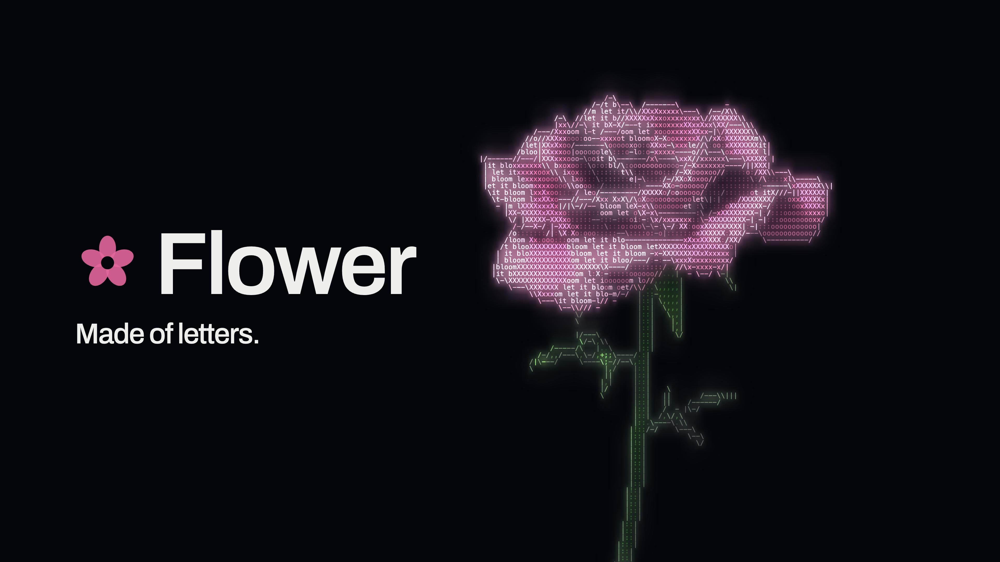
<br /><sub>The title card at beat 11.3. It is also frame 0 of the file, so it becomes the thumbnail wherever the film is posted.</sub>
</div>

<br />

`film/` is a page that renders a 60-second launch cut at **3840 × 2160, 60 frames a second**, entirely in the browser on your own GPU. The Flower engine draws every flower at native 4K, titles and interface are drawn as vector type, the browser's hardware encoder does the encoding through WebCodecs (HEVC at 60 Mb/s, or H.264 at 72 Mb/s), the sound is encoded as AAC at 320 kb/s, and the page writes the MP4 itself. On an Apple M4 Pro the whole film takes about 66 seconds, about 9 ms to draw each frame, and comes out at around 400 MB.

1. Open [`/film/`](https://msreeganeshnaik.github.io/flower/film/) in Chrome or another Chromium browser.
2. Add the track: your own copy of “Neon Dust – Vice City”, the full 3:05 MP3. It never leaves your computer.
3. Press **Render 4K film**, then **Save film**.

The cut is locked to that track at 105 beats a minute. The page edits the song down to exactly one minute from three pieces: the riser into the drop, the chorus, and the outro, each join a 30 ms equal-power crossfade placed just before a downbeat. Over it: a dot in silence, a bloom on the drop at 0:04.6, every flower, palette, character set and setting across the chorus, and the five endings in the outro, every cut on the beat. The full shot list is in [`film/SCRIPT.md`](film/SCRIPT.md). **The soundtrack is not in this repository**; to cut to another track, change the tempo and the edit list at the top of `film/src/audio.ts` and `film/src/film.ts`.

Details worth knowing: the sound is fed to the encoder 2,112 samples early, because an AAC encoder puts that much run-in at the head of the stream and players play it; the AAC encoder is never flushed mid-stream, because a flush pads and restarts the stream and clicks; and every engine and look is drawn once when the page opens, so cuts never stall.

---

## Run it

**Just use it:** open the [live site](https://msreeganeshnaik.github.io/flower/). It works in any current browser, on desktop and phone.

**Run it locally:**

```bash
npm install
npm run dev        # http://localhost:3000
npm run build      # static site in out/
npm test           # gift links: every setting survives encode, then decode
npx serve out      # preview the build
```

**The film page:**

```bash
npm run film                # builds film/artifact/app.js and app.css
npx serve film/artifact     # then open the address it prints in Chrome
```

<details>
<summary><b>Hosting, and the other builds</b></summary>
<br />

**GitHub Pages.** The `gh-pages` branch holds the built site: the app at `/flower/` and the film page at `/flower/film/`, plus `.nojekyll`. After changing `main`, publish with `npm run deploy`. For a fork under a different name, run `BASE_PATH=/your-repo npm run deploy`.

**Vercel.** Import the repository; it detects Next.js and needs no settings.

**Claude artifact.** `npm run artifact` builds `artifact/` (`index.html`, `app.js`, `app.css`, fonts inlined) for previewing inside Claude. It asks for Claude's `downloads` capability, so Record and Export image save through Claude's own save prompt (`lib/save.ts` picks the route).

**Render harness.** `npm run harness` builds `.harness/harness.js`, a bare page that draws one flower, scripted from the console, for checking the engine without the interface.

</details>

---

## How it is built

The engine is plain TypeScript with no dependencies. For every frame it samples the flower's surfaces as points, lights and shades them, and gives each cell of the grid one character; the browser's canvas then stamps those characters from a glyph atlas and adds the glow. The app around it is a static Next.js export.

| Where | What |
|---|---|
| `lib/engine/renderer.ts` | The renderer: petals, tubes and stems as sampled surfaces, the camera, the shadow map, shading, the character choice, glyph-atlas compositing and glow |
| `lib/engine/flowers.ts` | The seven flowers: whorls, petal shapes, centres, stems, leaves and the lotus leaf |
| `lib/engine/looks.ts` | Palettes, character sets, grounds and the five endings' timelines |
| `lib/engine/svg.ts` | SVG export, every character as live text |
| `components/Studio.tsx` | The clock, link state, recording and the gift view |
| `components/Panel.tsx`, `ExportDialog.tsx` | The controls, and the image and GIF export dialog |
| `lib/share.ts` | Gift links: every setting into the URL and back (`share.test.ts`) |
| `app/` | The page and the herbarium styles |
| `film/src/film.ts` | The film: beat grid, shots and titles |
| `film/src/audio.ts`, `encode.ts` | The one-minute edit of the track; WebCodecs encoding and MP4 writing |
| `film/src/plates.ts` | The eleven 4K plates in this README |
| `docs/DESIGN.md` | The design system: layout, tokens, motion |

**Performance notes**

- Between full bloom and the ending (and for ever in Stay) the petal points don't change, so the renderer reuses them and only turns the camera: about half the work per frame.
- Paused, the stage draws only when something changes. The quality saver times the drawing itself, so a 30 fps battery cap doesn't blur the flower.
- Export canvases are freed as soon as a file is made (Safari caps total canvas memory), and the export dialog and GIF encoder load only when first opened.

Flower began as a rebuild of a reel of a small pygame script, `bloom3d.py`, that spun a flower made of text. This is that idea taken much further.

---

## Credits

- [Next.js](https://nextjs.org/) and [React](https://react.dev/) (MIT)
- Fonts: [Archivo](https://fonts.google.com/specimen/Archivo) and [Courier Prime](https://fonts.google.com/specimen/Courier+Prime) (SIL Open Font License), via [Fontsource](https://fontsource.org/)
- [gifenc](https://github.com/mattdesl/gifenc) (MIT), for GIF export
- [mp4-muxer](https://github.com/Vanilagy/mp4-muxer) (MIT), for writing the film's MP4
- Built by **M. Sree Ganesh**, with Claude

<div align="center">
<br />
<sub><b>License:</b> <a href="LICENSE">MIT</a> © 2026 M. Sree Ganesh</sub>
</div>
